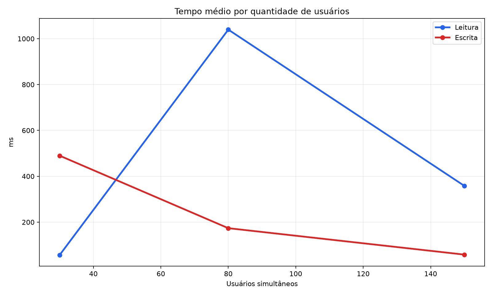
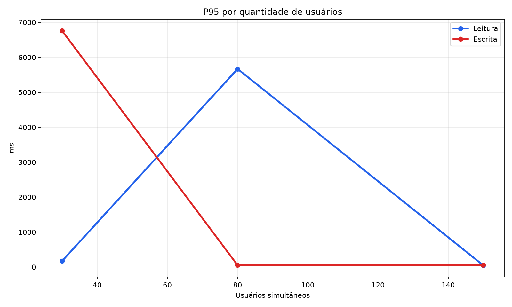
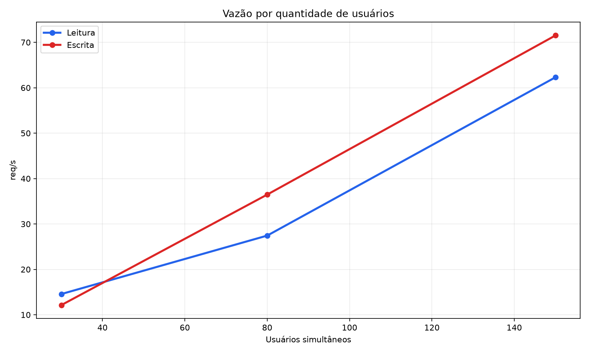
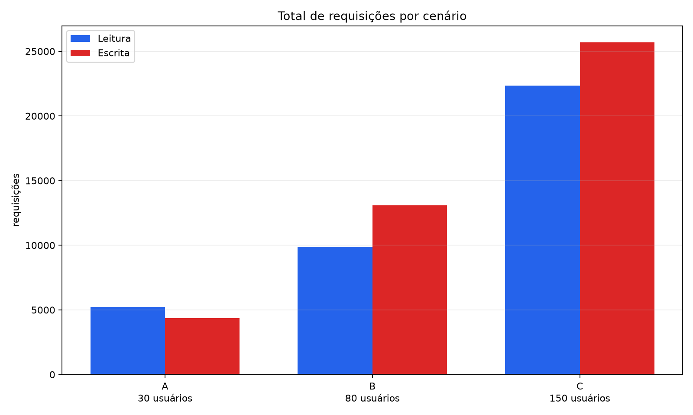
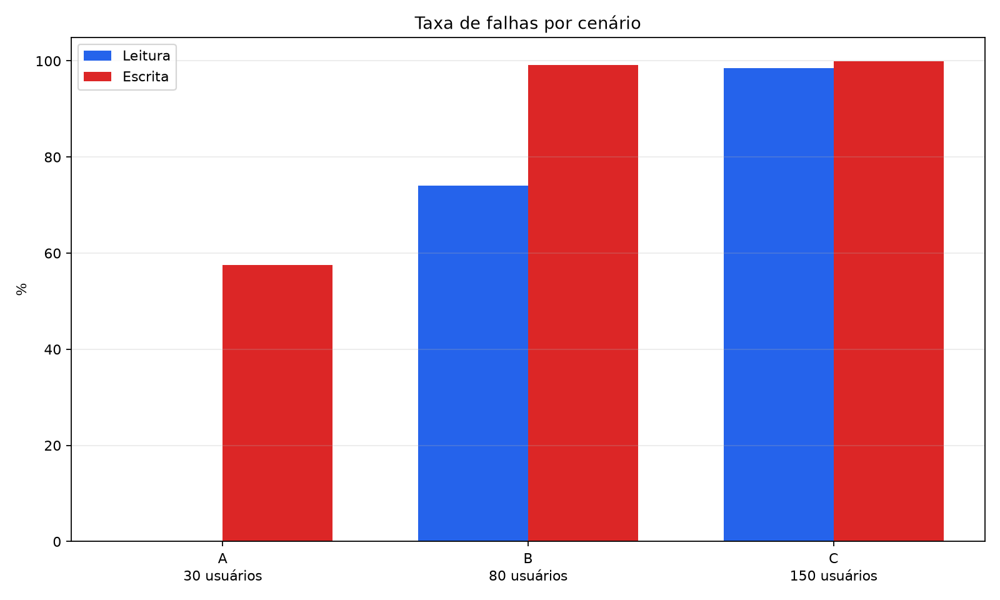
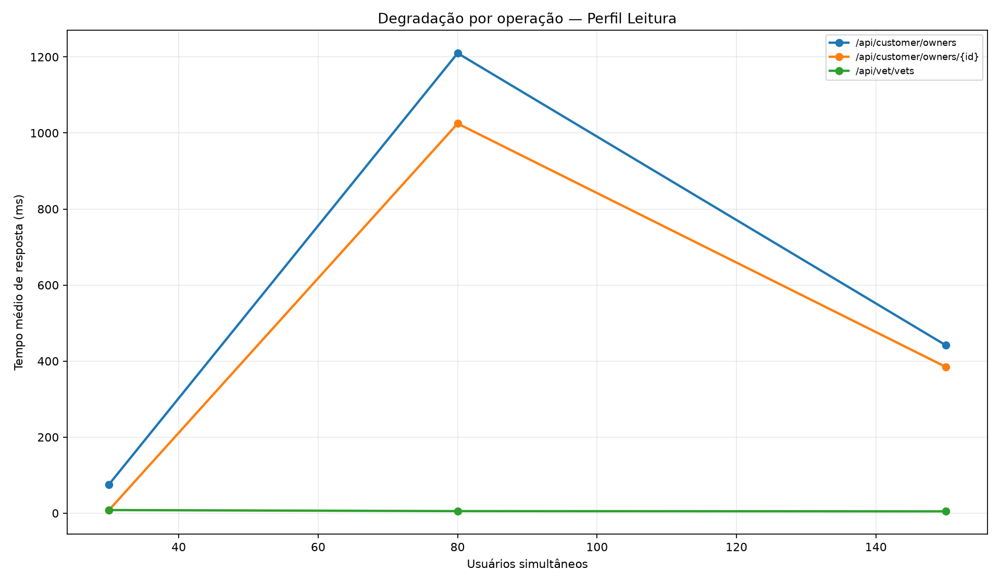
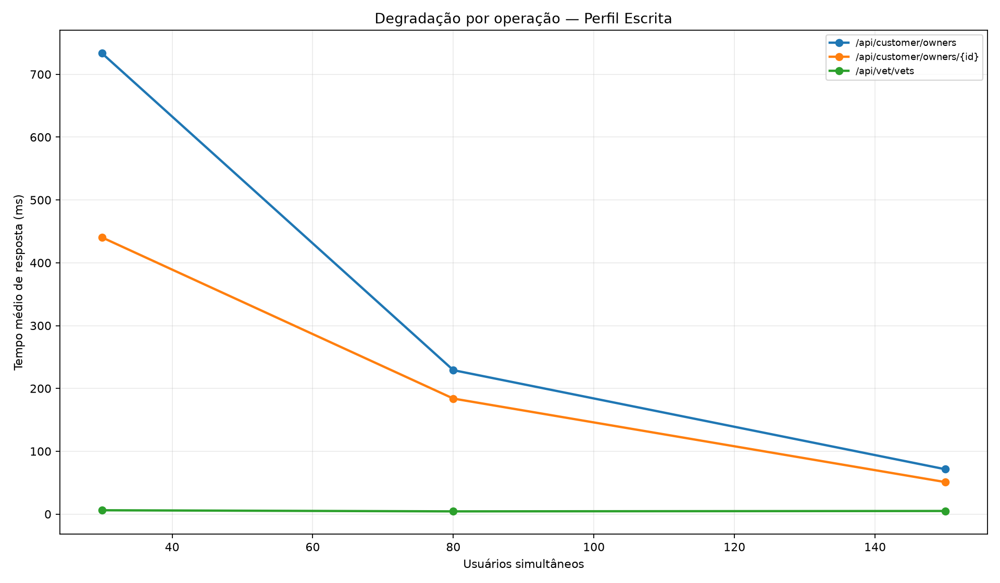
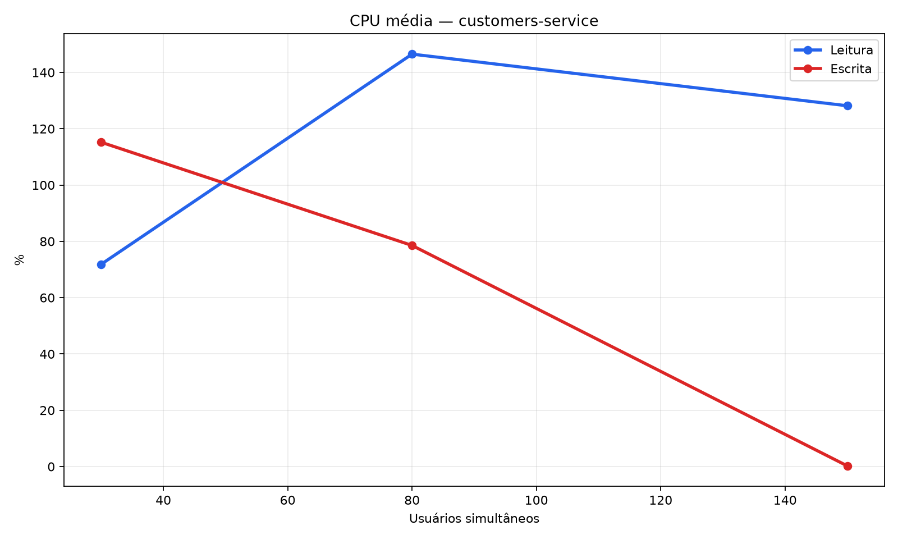
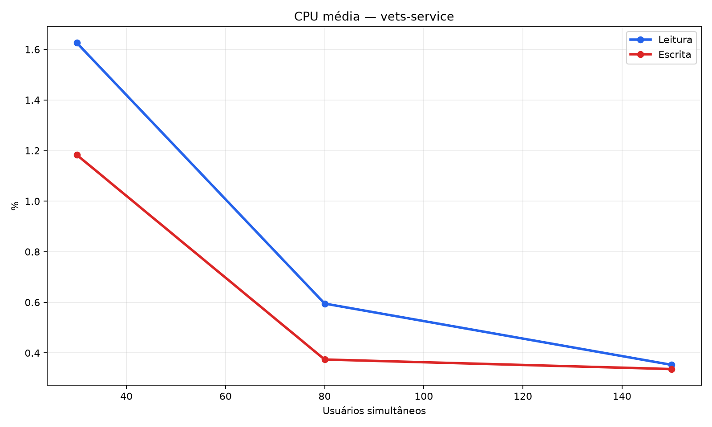

# Trabalho 06 - Avaliação de Desempenho de Microsserviços com Locust

     

Avaliação de desempenho do sistema distribuído **Spring PetClinic Microservices** utilizando **Locust**, **Docker Compose**, **Prometheus** e **Grafana**. O projeto executa dois perfis de carga — **Leitura** e **Escrita** — sobre diferentes quantidades de usuários, coletando tempo médio de resposta, P95, vazão, total de requisições, taxa de falhas e utilização de CPU dos microsserviços. Projeto acadêmico da disciplina de Sistemas Distribuídos.

## Sumário

- [Como rodar](#como-rodar)
  - [Pré-requisitos](#pré-requisitos)
  - [Rodar a aplicação](#rodar-a-aplicação)
  - [Rodar o experimento completo](#rodar-o-experimento-completo)
  - [Rodar o gerador de gráficos e tabelas](#rodar-o-gerador-de-gráficos-e-tabelas)
- [Estrutura do projeto](#estrutura-do-projeto)
- [Arquitetura](#arquitetura)
- [Descrição do ambiente de execução](#descrição-do-ambiente-de-execução)
- [Metodologia](#metodologia)
- [Análise dos resultados](#análise-dos-resultados)
- [Respostas às questões](#respostas-às-questões)
- [Conclusões](#conclusões)
- [Vídeo demonstrativo](#vídeo-demonstrativo)
- [Licença](#licença)

## Como rodar

### Pré-requisitos

- Docker Desktop em execução;
- Docker Compose disponível;
- Python 3.13 ou compatível;
- Git;
- pelo menos 4 GB de memória disponíveis para os serviços;
- ambiente virtual Python criado em `ads/.venv`.

Instale as dependências do projeto com:

```powershell
.\ads\.venv\Scripts\python.exe -m pip install -r .\ads\requirements.txt
```

### Rodar a aplicação

Clone o repositório da aplicação no diretório raiz:

```powershell
git clone https://github.com/spring-petclinic/spring-petclinic-microservices.git
```

Entre na pasta da aplicação:

```powershell
Set-Location .\spring-petclinic-microservices
```

Inicie os serviços com Docker Compose:

```powershell
docker compose up -d
```

Verifique o estado dos containers:

```powershell
docker compose ps
```

Interfaces disponíveis:

| Serviço | URL |
|---|---|
| Aplicação/API Gateway | http://localhost:8080 |
| Locust | http://localhost:8089 |
| Grafana | http://localhost:3030 |
| Prometheus | http://localhost:9091 |
| Spring Boot Admin | http://localhost:9090 |

Para encerrar a aplicação:

```powershell
docker compose down
```

### Rodar o experimento completo

Certifique-se de que a aplicação está em execução e volte para a raiz do repositório:

```powershell
Set-Location ..
```

Execute os dois perfis, os três cenários e as 10 repetições por configuração:

```powershell
.\ads\.venv\Scripts\python.exe .\ads\experiments\run_experiments.py `
  --locust-command .\ads\.venv\Scripts\locust.exe
```

O experimento completo possui:

```text
2 perfis × 3 cenários × 10 repetições = 60 execuções
```

Cada execução realiza:

- 1 minuto de aquecimento;
- reinício das estatísticas do Locust;
- 6 minutos de medição;
- coleta de CPU e memória dos containers `customers-service` e `vets-service`.

### Rodar o gerador de gráficos e tabelas

Após a conclusão dos experimentos, execute:

```powershell
.\ads\.venv\Scripts\python.exe .\ads\experiments\generate_results.py
```

As tabelas serão salvas em:

```text
ads/results/processed/
```

Os gráficos serão salvos em:

```text
ads/results/charts/
```

O gerador pode ser executado novamente após novas repetições. Ele processará todos os arquivos brutos disponíveis.

## Estrutura do projeto

```text
.
├── ads/
│   ├── experiments/
│   │   ├── generate_results.py
│   │   └── run_experiments.py
│   ├── grafana-petclinic-dashboard-trabalho06.json
│   ├── locustfile.py
│   ├── requirements.txt
│   └── results/
│       ├── charts/
│       ├── processed/
│       └── raw/
│
├── spring-petclinic-microservices/
├── .gitignore
├── LICENSE
└── README.md
```

Os resultados brutos são separados por execução e incluem arquivos CSV do Locust, amostras do `docker stats`, logs e metadados.

## Arquitetura

O sistema avaliado é composto por microsserviços Spring PetClinic executados em containers Docker:

```text
Locust
   │
   ▼
API Gateway :8080
   ├── Customers Service :8081
   ├── Visits Service   :8082
   └── Vets Service     :8083

Prometheus :9091 ──► métricas Actuator/Prometheus
Grafana    :3030 ──► visualização das métricas
```

O Locust envia as requisições pelo API Gateway. O Prometheus coleta métricas dos serviços e o Grafana permite acompanhar o comportamento da aplicação durante os testes. O script experimental utiliza o `docker stats` para coletar oficialmente a utilização de CPU de dois serviços: `customers-service` e `vets-service`.

## Descrição do ambiente de execução

Preencher antes da entrega final:

| Item | Informação |
|---|---|
| Sistema operacional |  Microsoft Windows 11 Home Single Language |
| Processador | 12th Gen Intel(R) Core(TM) i5-12450H (2.00 GHz) |
| Memória RAM | 16,0 GB (utilizável: 15,7 GB) |
| Versão do Docker | 29.7.2 |
| Versão do Docker Compose | 5.5.1 |
| Versão do Python | 3.13.5 |
| Versão do Locust | 2.46.7 |
| Serviços monitorados | `customers-service` e `vets-service` |
| Limite de memória dos serviços | 512 MB |
| Intervalo do `docker stats` | 5 segundos |

## Metodologia

Foram definidos dois perfis de carga:

| Operação | Perfil Leitura | Perfil Escrita |
|---|---:|---:|
| `GET /api/customer/owners` | 45% | 20% |
| `GET /api/customer/owners/{id}` | 35% | 20% |
| `GET /api/vet/vets` | 15% | 20% |
| `POST /api/customer/owners` | 5% | 40% |

Cada perfil será executado nos seguintes cenários:

| Cenário | Usuários | Aquecimento | Medição |
|---|---:|---:|---:|
| A — Leve | 30 | 1 minuto | 6 minutos |
| B — Moderado | 80 | 1 minuto | 6 minutos |
| C — Elevado | 150 | 1 minuto | 6 minutos |

Cada configuração será repetida 10 vezes, totalizando:

```text
2 perfis × 3 cenários × 10 repetições = 60 execuções
```

Durante o aquecimento, as estatísticas não são utilizadas. Após 1 minuto, uma nova medição do Locust é iniciada com as estatísticas zeradas. Somente os 6 minutos seguintes são salvos nos CSVs oficiais.

As métricas coletadas são:

- tempo médio de resposta, em milissegundos;
- P95 do tempo de resposta, em milissegundos;
- vazão, em requisições por segundo;
- total de requisições;
- taxa de falhas;
- utilização de CPU dos serviços `customers-service` e `vets-service`.

Os resultados são analisados por cenário, perfil e operação. As médias das repetições são geradas pelo script `generate_results.py`.

## Análise dos resultados

Foram executadas as 60 medições previstas. As tabelas consolidadas estão em [`ads/results/processed/`](./ads/results/processed/) e os gráficos em [`ads/results/charts/`](./ads/results/charts/).

### Tabelas

#### Métricas agregadas por perfil e cenário

| Perfil | Cenário | Usuários | Tempo médio (ms) | P95 (ms) | Vazão (req/s) | Requisições | Taxa de falhas |
|---|---:|---:|---:|---:|---:|---:|---:|
| Leitura | A | 30 | 56,89 | 172,20 | 14,57 | 5.227,9 | 0,00% |
| Leitura | B | 80 | 1.039,59 | 5.669,00 | 27,44 | 9.845,0 | 74,05% |
| Leitura | C | 150 | 358,18 | 48,10 | 62,31 | 22.345,6 | 98,55% |
| Escrita | A | 30 | 489,79 | 6.759,00 | 12,13 | 4.353,2 | 57,56% |
| Escrita | B | 80 | 173,71 | 51,80 | 36,47 | 13.089,7 | 99,12% |
| Escrita | C | 150 | 58,44 | 52,10 | 71,52 | 25.689,9 | 99,91% |

Os valores acima são médias das 10 repetições de cada configuração. Cada repetição representa seis minutos de medição após o aquecimento. O script calcula as métricas de cada repetição e depois calcula a média da configuração; portanto, os números descrevem o comportamento médio das repetições, e não necessariamente uma única execução. Isso é importante porque algumas repetições começaram com o ambiente mais degradado do que outras.

Teoricamente, o aumento do número de usuários concorrentes tende a aumentar a taxa de chegada de requisições. Enquanto a capacidade de serviço dos microsserviços é suficiente, a fila permanece pequena e a latência cresce pouco. Quando a chegada se aproxima ou ultrapassa a capacidade de processamento, as requisições passam a esperar por threads, conexões, CPU, memória ou dependências internas. Nesse regime, o tempo de resposta cresce, a vazão tende a atingir um limite e a probabilidade de erro aumenta. Essa tabela permite identificar essa transição porque reúne, na mesma linha, latência, volume, vazão e confiabilidade.

O cenário Leitura A é o único conjunto completamente saudável: 30 usuários produziram 14,57 req/s, 56,89 ms de tempo médio, P95 de 172,20 ms e 0% de falhas. Ao passar para Leitura B, a carga aumentou 166,7% (de 30 para 80 usuários), mas o tempo médio subiu para 1.039,59 ms e o P95 para 5.669 ms. O aumento do P95 é particularmente relevante: além de a média ter piorado, as requisições mais lentas passaram a esperar vários segundos, caracterizando formação de filas e comportamento instável. A taxa de falhas de 74,05% confirma que o sistema já havia ultrapassado sua capacidade sustentável.

No cenário Leitura C, a vazão sobe para 62,31 req/s e o total de requisições aumenta para 22.345,6, mas 98,55% das requisições falham. Portanto, a aparente capacidade de gerar mais requisições não deve ser confundida com capacidade de atender mais usuários. Aproximadamente apenas 1,45% das requisições foram bem-sucedidas em média. O tempo médio de 358,18 ms e o P95 de 48,10 ms também não contradizem essa conclusão: respostas de erro, como `405` e `503`, podem ser produzidas rapidamente e passam a dominar a distribuição.

O Perfil Escrita é mais pesado para o `customers-service` porque atribui 40% da carga à operação POST de criação de owners. Mesmo com apenas 30 usuários, o cenário A já apresenta 57,56% de falhas e P95 de 6.759 ms. Nos cenários B e C, as falhas chegam a 99,12% e 99,91%. Assim, o perfil Escrita apresenta menor capacidade sustentável no ambiente medido. A coluna de vazão deve ser lida como volume de respostas/requisições concluídas pelo Locust, incluindo respostas malsucedidas; ela não é uma medida de vazão útil sem a coluna de falhas.

#### Utilização de CPU

| Perfil | Cenário | Serviço | CPU média (%) | CPU máxima média (%) | Memória média (%) |
|---|---:|---|---:|---:|---:|
| Leitura | A | `customers-service` | 71,86 | 181,54 | 87,41 |
| Leitura | B | `customers-service` | 146,49 | 271,79 | 94,64 |
| Leitura | C | `customers-service` | 128,15 | 242,24 | 94,86 |
| Leitura | A | `vets-service` | 1,63 | 10,41 | 69,46 |
| Leitura | B | `vets-service` | 0,60 | 6,10 | 70,41 |
| Leitura | C | `vets-service` | 0,35 | 2,74 | 71,05 |
| Escrita | A | `customers-service` | 115,18 | 212,08 | 86,50 |
| Escrita | B | `customers-service` | 78,54 | 122,89 | 89,87 |
| Escrita | C | `customers-service` | 0,25 | 2,11 | 91,25 |
| Escrita | A | `vets-service` | 1,18 | 6,72 | 69,51 |
| Escrita | B | `vets-service` | 0,37 | 3,84 | 70,89 |
| Escrita | C | `vets-service` | 0,34 | 2,67 | 71,13 |

Valores acima de 100% no `docker stats` representam uso acumulado de mais de um núcleo de CPU.

Essa tabela identifica a relação entre carga e recursos dos containers. A CPU média é a utilização observada nas amostras do `docker stats` durante a medição. A CPU máxima média é a média dos maiores valores de cada repetição; ela ajuda a perceber picos que a média pode esconder. A memória média indica pressão persistente sobre o container, mas não equivale, por si só, a uma medição de vazamento. Como o Docker soma o uso de múltiplos núcleos, 100% não significa necessariamente que toda a máquina está ocupada: significa aproximadamente um núcleo lógico totalmente utilizado pelo container.

No Perfil Leitura, o `customers-service` passa de 71,86% de CPU média no cenário A para 146,49% no B, enquanto a memória sobe de 87,41% para 94,64%. Essa combinação é compatível com saturação: mais trabalho concorrente exige mais CPU e mantém mais objetos/requisições em memória. O pico médio de 271,79% no cenário B mostra que a pressão não foi apenas um valor ocasional de uma única repetição. No cenário C, a CPU média ainda é alta (128,15%) e a memória permanece em 94,86%, mas a taxa de falhas chega a 98,55%, indicando que o serviço está sob pressão e não consegue transformar a carga em atendimento bem-sucedido.

No Perfil Escrita, o cenário A já começa com 115,18% de CPU média e 212,08% de CPU máxima média, coerente com o custo adicional das operações de escrita. Depois, a CPU cai para 78,54% no cenário B e 0,25% no C, enquanto a memória continua subindo para 89,87% e 91,25%. Essa queda não é evidência de otimização: com 99,12% e 99,91% de falhas, respectivamente, o serviço provavelmente rejeitou ou deixou de processar a maior parte da carga. Em um sistema saturado, CPU baixa pode significar bloqueio, indisponibilidade, rejeição antecipada ou dependência fora do ar; por isso, CPU deve sempre ser correlacionada com latência e falhas.

O `vets-service` permanece abaixo de 2% de CPU média em todos os cenários. Como as operações de veterinários não provocaram crescimento comparável de latência e o serviço não apresenta picos sustentados, os dados não apontam esse container como gargalo principal. A diferença entre os serviços direciona a investigação para o caminho de owners e para o `customers-service`.

### Gráficos



**Interpretação — tempo médio:** em teoria, o tempo médio é a soma do tempo de processamento com o tempo de espera em filas e dependências, dividida pelo número de respostas. Por isso, ele é um indicador direto de latência média, mas pode esconder uma minoria de respostas extremamente lentas e pode ser distorcido quando há muitos erros rápidos. O gráfico testa a primeira pergunta do trabalho: se o aumento de usuários afeta o tempo de resposta.

No Perfil Leitura, a curva sobe de 56,89 ms para 1.039,59 ms entre A e B: aproximadamente 18 vezes mais latência para um aumento de 30 para 80 usuários. Esse salto é evidência prática de que o sistema deixou a região de operação confortável e passou a gastar tempo esperando por recursos. No cenário C, a curva desce para 358,18 ms, mas a interpretação correta exige cruzar o gráfico com a taxa de falhas: 98,55% das respostas falharam. Assim, o valor menor não significa que 150 usuários foram atendidos mais rapidamente; significa que a maioria recebeu respostas de erro que não percorrem o caminho completo de sucesso.

No Perfil Escrita, a curva começa em 489,79 ms e desce para 173,71 ms e 58,44 ms. Isoladamente, pareceria que mais usuários melhoraram o tempo de resposta, o que é contrário ao comportamento esperado em saturação. A taxa de falhas resolve essa aparente contradição: 57,56%, 99,12% e 99,91% nos cenários A, B e C. Portanto, a curva mostra a latência média das respostas observadas, não a qualidade do serviço para requisições concluídas com sucesso.



**Interpretação — P95:** o percentil 95 é o valor abaixo do qual se encontram 95% das respostas; somente os 5% mais lentos ficam acima dele. Diferentemente da média, ele representa melhor a experiência de usuários que enfrentam a cauda de latência, que em sistemas distribuídos pode ser causada por filas, retries, timeouts, contenção de conexões e dependências lentas. Um P95 alto significa que o sistema não está apenas ocasionalmente lento: uma parcela significativa dos usuários está sendo afetada.

O Perfil Leitura A tem P95 de 172,20 ms, mas no B o valor chega a 5.669 ms. Isso significa que, no cenário B, até o limite dos 95% mais rápidos ficou na ordem de segundos, evidenciando uma cauda muito severa. O Perfil Escrita A apresenta P95 de 6.759 ms, sinal de que a escrita já enfrentava longas esperas mesmo com 30 usuários. A comparação entre perfis mostra que a operação de escrita exerce pressão maior desde a menor carga.

Os valores de 48,10 ms no Leitura C e 52,10 ms no Escrita C não devem ser usados para afirmar que o sistema ficou mais rápido. Com taxas de falha de 98,55% e 99,91%, respectivamente, os poucos sucessos podem ser mascarados por respostas de erro rápidas. O P95 calculado sobre todas as respostas não separa sucesso de falha; idealmente, seria necessário reportar P95 de sucesso e P95 de erro separadamente. Dentro desta metodologia, o gráfico é válido para descrever as respostas coletadas, mas sua interpretação de qualidade precisa ser condicionada à confiabilidade.



**Interpretação — vazão:** vazão é a quantidade de requisições concluídas por unidade de tempo. Em uma situação saudável, aumentar os usuários inicialmente aumenta a vazão porque há mais trabalho concorrente; depois, ao atingir a capacidade do sistema, a vazão tende a estabilizar enquanto a latência e as falhas aumentam. O gráfico mostra a vazão registrada pelo Locust, mas ela inclui respostas bem-sucedidas e malsucedidas. Por isso, para avaliar desempenho útil, é necessário considerar também a vazão de sucesso, que pode ser estimada por `vazão × (1 - taxa de falhas)`.

Os dados mostram crescimento de 14,57 para 27,44 e 62,31 req/s no Perfil Leitura e de 12,13 para 36,47 e 71,52 req/s no Perfil Escrita. Entretanto, aplicando a taxa de sucesso, o cenário Leitura C teria aproximadamente 0,90 req/s de sucesso e o Escrita C aproximadamente 0,06 req/s. Esses valores aproximados são muito inferiores à vazão bruta exibida no gráfico. Portanto, o gráfico responde qual cenário gerou mais respostas por segundo, mas a taxa de falhas responde se essas respostas representam serviço efetivo. O Perfil Escrita não tem maior desempenho real nos cenários B e C; ele apenas produziu mais respostas, predominantemente erros.



**Interpretação — total de requisições:** este gráfico mostra o volume acumulado durante os seis minutos de medição. Ele é uma medida de carga aplicada e de respostas encerradas, não uma medida de produtividade bem-sucedida. Com mais usuários, o Locust possui mais clientes gerando tarefas concorrentes; por isso, é esperado que o total cresça quando o sistema responde rapidamente, inclusive com erros rápidos. Se as requisições ficarem bloqueadas em timeouts, o crescimento pode ser menor, mesmo sob carga maior.

O Perfil Leitura passa de 5.227,9 requisições no cenário A para 22.345,6 no C; o Perfil Escrita passa de 4.353,2 para 25.689,9. O aumento confirma que os cenários mais pesados geraram maior pressão sobre a aplicação. Contudo, como o total e a taxa de falhas apresentados são médias calculadas separadamente por repetição, não se deve multiplicá-los para criar uma contagem oficial de sucessos. A conclusão segura é qualitativa: nos cenários C, a parcela bem-sucedida foi muito pequena apesar do total bruto elevado.



**Interpretação — taxa de falhas:** a taxa de falhas é a razão entre requisições que terminaram com erro e o total de requisições da repetição. Ela é o indicador de confiabilidade da tabela e define se uma queda de latência ou um aumento de vazão representa melhoria real. Em sistemas distribuídos, falhas podem surgir por método não permitido, indisponibilidade de serviço, timeout, saturação de pool ou erro de dependência; nos dados observados, destacaram-se `405 Method Not Allowed` e `503 Service Unavailable`.

O Perfil Leitura evolui de 0% no cenário A para 74,05% no B e 98,55% no C. Isso caracteriza uma perda progressiva de confiabilidade: no B, aproximadamente três em cada quatro requisições falham; no C, quase 99 em cada 100 falham. O Perfil Escrita é mais crítico ainda: mais da metade já falha no cenário A, e os cenários B e C praticamente deixam de oferecer atendimento bem-sucedido. O gráfico responde diretamente qual cenário apresenta mais falhas: C nos dois perfis, com o pior valor no Escrita C.

O padrão também ajuda a distinguir saturação de uma simples variação de latência. Se a latência aumentasse mas a taxa de falhas permanecesse baixa, haveria degradação de desempenho ainda com confiabilidade. Aqui, a latência e a confiabilidade pioram juntas nas execuções mais representativas, indicando que o sistema ultrapassou seu limite operacional.



**Interpretação — degradação das operações de Leitura:** o gráfico desagrega a média geral por endpoint. Essa separação é importante porque um perfil é uma mistura ponderada de operações; uma operação muito lenta pode ser ocultada por outra operação rápida. Cada linha mostra como a latência média daquela operação muda com a carga, permitindo localizar qual caminho do sistema perde desempenho primeiro.

As operações de owners dependem do `customers-service` e apresentam a maior degradação. O endpoint `GET /api/customer/owners/{id}` se destaca pelo maior crescimento relativo entre A e C, enquanto `GET /api/customer/owners` apresenta aumento absoluto mais expressivo. Em termos de teoria de filas, isso sugere que as operações que compartilham o recurso de clientes competem pela mesma capacidade de serviço. Já `GET /api/vet/vets` permanece mais estável, coerente com o baixo uso do `vets-service` na tabela de CPU.

O gráfico não deve ser lido apenas pela altura das linhas. Nos cenários mais carregados, a composição entre respostas de sucesso e erro muda drasticamente. Uma linha que desce pode estar refletindo erros rápidos, e não uma operação realmente otimizada. A maior degradação operacional deve ser determinada combinando a latência, o percentual de falhas e o serviço responsável.



**Interpretação — degradação das operações de Escrita:** este gráfico mostra o efeito de aumentar a participação da operação POST de criação de owners. Escritas normalmente envolvem validação, persistência e, eventualmente, chamadas a outros serviços; por isso, tendem a consumir mais recursos e a permanecer mais tempo ocupando conexões e threads. O Perfil Escrita dá 40% de peso à criação de owners, contra 5% no Perfil Leitura, o que explica a maior sensibilidade já no cenário A.

As linhas das operações do `customers-service` concentram a degradação e os erros. Contudo, a queda de latência aparente nos cenários B e C não pode ser interpretada como ganho de desempenho: as taxas de falha nesses cenários são 99,12% e 99,91%. O gráfico, portanto, cumpre o papel de apontar quais operações estão associadas ao caminho problemático, mas a qualidade da operação só pode ser avaliada considerando respostas bem-sucedidas. Para uma análise mais rigorosa, seria ideal separar no futuro as distribuições de latência por código HTTP.



**Interpretação — CPU do `customers-service`:** este gráfico relaciona a pressão de carga com o recurso do serviço que concentra as operações de owners. A expectativa teórica é que a CPU cresça com os usuários até algum limite; depois disso, podem surgir filas, erros e queda da capacidade efetiva. O gráfico confirma essa pressão nos primeiros níveis: Leitura B alcança 146,49% de CPU média e Escrita A alcança 115,18%, acompanhadas por latência elevada ou falhas.

O ponto mais importante é a interpretação da queda no Escrita C para 0,25%. Se ela representasse eficiência, seria acompanhada por baixa taxa de falhas; ocorre o oposto, com 99,91% de erros e memória média de 91,25%. A explicação mais consistente com o conjunto de dados é que o serviço entrou em estado degradado e deixou de executar efetivamente as requisições, não que tenha processado 150 usuários com baixo custo. Os valores acima de 100% são válidos no `docker stats` porque representam o uso acumulado de múltiplos núcleos.



**Interpretação — CPU do `vets-service`:** este gráfico funciona como comparação com o `customers-service`. A CPU média permanece abaixo de 2% em todos os cenários, e os picos médios também são baixos. Se o `vets-service` fosse o gargalo dominante, seria esperado observar aumento de CPU, crescimento de latência nas operações de vets e falhas concentradas nesse caminho. Esse padrão não aparece nos resultados.

Assim, a baixa CPU não significa que o serviço não recebeu requisições; significa que ele não aparenta ter sido o recurso limitante. A estabilidade do gráfico, combinada com a pressão do `customers-service`, sustenta a conclusão de que a degradação principal ocorreu no fluxo de clientes/owners. Ela também evita uma conclusão incorreta de que todos os microsserviços foram igualmente afetados.

### Observações

O Perfil Leitura começou estável no cenário A: as 10 repetições tiveram 0% de falhas. No cenário B, as duas primeiras repetições também não tiveram falhas, mas a partir da terceira a taxa de falhas subiu para 68,30% e permaneceu próxima de 95% nas repetições seguintes. No cenário C, todas as repetições ficaram entre 98,38% e 98,82% de falhas.

O Perfil Escrita apresentou degradação ainda mais cedo. As três primeiras repetições do cenário A tiveram 0% de falhas; a partir da quarta, a taxa ficou entre 67,21% e 93,65%. Os cenários B e C apresentaram médias de 99,12% e 99,91% de falhas, respectivamente.

Esse padrão mostra que os resultados foram influenciados por degradação acumulada do ambiente durante a execução sequencial. Portanto, as médias são o retrato do conjunto de execuções realizadas, mas não devem ser interpretadas como uma comparação completamente isolada entre níveis de carga. O aumento progressivo da memória do `customers-service`, a ocorrência de respostas `405 Method Not Allowed` e `503 Service Unavailable` e a redução da CPU após a indisponibilidade sugerem que o serviço entrou em estado degradado.

Os P95 dos cenários com taxa de falhas próxima de 100% devem ser interpretados com cautela: respostas de erro rápidas dominam a distribuição e podem produzir um P95 baixo, sem representar a latência das poucas requisições bem-sucedidas.

## Respostas às questões

### 1. Como o aumento de usuários afeta o tempo de resposta?

No Perfil Leitura, o tempo médio passou de 56,89 ms no cenário A para 1.039,59 ms no cenário B. O valor médio do cenário C caiu para 358,18 ms, mas essa redução não representa melhora: o cenário C teve 98,55% de falhas, fazendo com que muitas respostas de erro rápidas dominassem a métrica. No Perfil Escrita, o cenário A teve 489,79 ms, enquanto B e C tiveram 173,71 ms e 58,44 ms, respectivamente, também com taxas de falha de 99,12% e 99,91%. Assim, a tendência confiável é de degradação e saturação; os valores menores nos cenários mais pesados são consequência da indisponibilidade, não de melhor desempenho.

### 2. Qual perfil apresenta maior vazão?

Pelos valores agregados, o Perfil Leitura apresentou maior vazão no cenário A (14,57 contra 12,13 req/s), enquanto o Perfil Escrita apresentou maior vazão nos cenários B e C (36,47 e 71,52 req/s contra 27,44 e 62,31 req/s). Essa comparação deve ser qualificada pela taxa de falhas: as vazões maiores do Perfil Escrita ocorreram com 99,12% e 99,91% de falhas, portanto não representam maior capacidade de atendimento bem-sucedido.

### 3. Quais operações apresentam maior degradação?

No Perfil Leitura, as operações do `customers-service` foram as mais afetadas. A consulta `GET /api/customer/owners/{id}` apresentou o maior aumento relativo entre A e C, enquanto `GET /api/customer/owners` apresentou grande aumento absoluto de latência. `GET /api/vet/vets` permaneceu estável, indicando que o `vets-service` não foi o principal gargalo. No Perfil Escrita, a comparação da latência entre A, B e C fica comprometida pela elevada taxa de falhas; ainda assim, as operações de owners concentram as falhas e evidenciam a degradação do `customers-service`.

### 4. Como o consumo de CPU varia entre os cenários?

O `customers-service` foi o serviço mais pressionado. No Perfil Leitura, sua CPU média passou de 71,86% no cenário A para 146,49% no cenário B e 128,15% no cenário C. No Perfil Escrita, passou de 115,18% no cenário A para 78,54% no cenário B e 0,25% no cenário C. A queda nos cenários mais pesados não indica melhora: coincide com taxas de falha próximas de 100% e sugere que o serviço deixou de processar efetivamente as requisições. O `vets-service` permaneceu abaixo de 2% de CPU média em todos os cenários, reforçando que o principal ponto de pressão foi o serviço de clientes.

### 5. Qual cenário apresenta maior taxa de falhas?

O cenário C apresentou a maior taxa média de falhas nos dois perfis: 98,55% no Perfil Leitura e 99,91% no Perfil Escrita. O Perfil Escrita foi o mais crítico, pois já atingiu 99,12% de falhas no cenário B. Os erros registrados foram principalmente `405 Method Not Allowed` nas operações GET e `503 Service Unavailable` nos POSTs.

## Conclusões

Os resultados indicam que o sistema apresentou comportamento aceitável apenas nas primeiras execuções com carga leve e, em parte, nas primeiras execuções do Perfil Leitura com carga moderada. Com a continuidade da bateria, surgiram respostas `405` e `503`, aumento de falhas e crescimento do uso de memória do `customers-service`.

O Perfil Escrita foi o mais crítico: atingiu taxa média de falhas de 99,12% no cenário B e 99,91% no cenário C. O cenário C foi o cenário de maior taxa de falhas em ambos os perfis. O `customers-service` foi o componente mais pressionado, enquanto o `vets-service` permaneceu com baixo uso de CPU.

Ainda assim, a conclusão principal é que o aumento da carga, especialmente no Perfil Escrita, ultrapassou a capacidade sustentável do ambiente avaliado. O sistema não manteve uma taxa de sucesso aceitável nos cenários moderado e elevado após a degradação.

## Vídeo demonstrativo

Link do vídeo:

[clique aqui para assistir o vídeo no youtube](https://youtu.be/t1QC0g-IHyY)

## Licença

Este projeto está disponibilizado sob a licença [BSD 3-Clause License](./LICENSE)

Projeto acadêmico da disciplina de Sistemas Distribuídos — UFPI.
